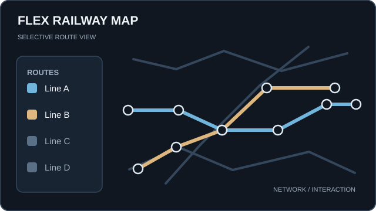
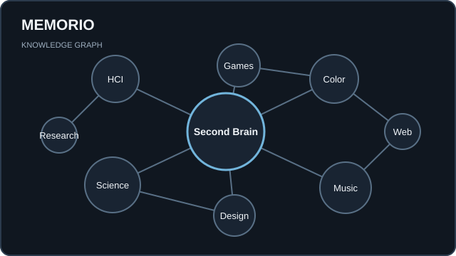
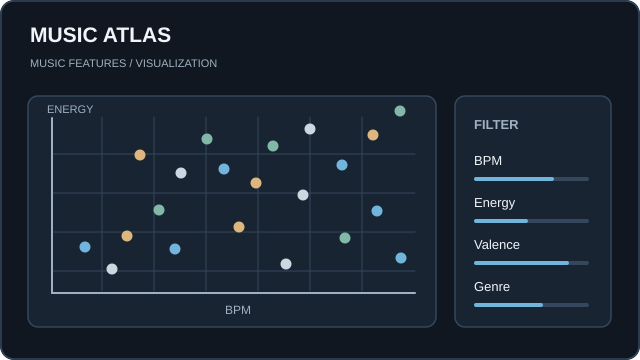
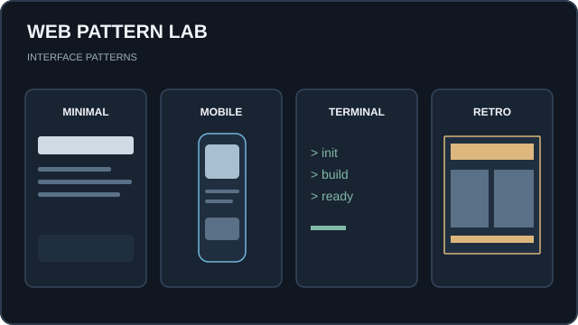
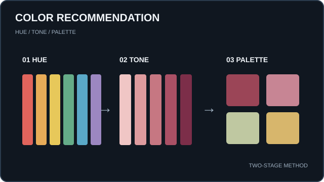

  <a href="https://emar27181-resume.netlify.app/">Portfolio</a> ·
  <a href="https://emar27181-gallery-portfolio.netlify.app/">Gallery</a> ·
  <a href="https://github.com/emar27181?tab=repositories">Repositories</a>

# emar27181

**Backend Engineer / Web Developer**

API · Interactive Web · Visualization

Meiji University, M.S. in Computer Science (2026) / 明治大学大学院 修了

##  Selected Works

<table>
  <tr>
    <td width="50%" align="center" valign="top">
      
       <strong><a href="https://github.com/emar27181/flex-rail-map-project">Flex Railway Map</a></strong>
       Interactive Railway Map
    </td>
    <td width="50%" align="center" valign="top">
      
       <strong><a href="https://github.com/emar27181/memorio">Memorio</a></strong>
       Knowledge Graph / Second Brain
    </td>
  </tr>
  <tr>
    <td width="50%" align="center" valign="top">
      
       <strong><a href="https://github.com/emar27181/music-atras">Music Atlas</a></strong>
       Music Analytics / Visualization
    </td>
    <td width="50%" align="center" valign="top">
      
       <strong><a href="https://github.com/emar27181/web-pattern-lab">Web Pattern Lab</a></strong>
       UI Patterns / Design Systems
    </td>
  </tr>
</table>

Concept diagrams / 概念図（実際の画面キャプチャではありません）

##  Stack

REST API · API Gateway · Lambda · DynamoDB · Hono

##  Research

**配色推薦によるイラスト制作支援** / Color Palette Recommendation for Illustration

<a href="https://ec2025.entcomp.org/">EC2025</a> ·
<a href="https://ec2025.entcomp.org/award/">Award page</a> ·
<a href="https://www.youtube.com/watch?v=Sr1CyI3407c">Demo video</a>
&nbsp; | &nbsp;
<a href="https://ipsj.ixsq.nii.ac.jp/records/238714">EC2024 Paper</a>
&nbsp; | &nbsp;
<a href="https://www.interaction-ipsj.org/proceedings/2024/data/bib/3B-27.html">Interaction2024</a>

##  Activity

 &nbsp; Views are image loads, not unique visitors.

---

  <a href="https://emar27181-resume.netlify.app/">Portfolio</a> ·
  <a href="https://emar27181-gallery-portfolio.netlify.app/">Gallery</a> ·
  <a href="mailto:ryunosukeema.job@gmail.com">Contact</a>

